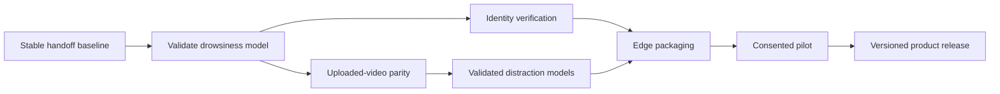

# Product Roadmap

## Product objective

Deliver an offline-first laptop/edge application that detects a visible driver,
estimates drowsiness from a calibrated temporal model, confirms sustained risk,
and stores auditable local events without requiring an Internet connection.

The roadmap deliberately separates **verified product behavior** from research
artifacts. A feature enters the main UI only after its model contract, test set,
runtime cost and failure behavior are documented.

## Development direction

Immediate critical path: finish Stage 1 before adding more visible behavior
cards. The largest current product risk is model validity in real cabin
conditions, not the absence of another UI feature.

## Stage 0 - Stable handoff baseline

Target: a new developer can install, verify and run the current drowsiness flow.

- One default backend: `driver_safety_v1`.
- Artifact manifest with immutable hashes and `15 x 6` feature order.
- Model and camera health endpoints.
- Offline Socket.IO asset and local SQLite persistence.
- Legacy research routes disabled by default.

Acceptance criteria:

- `verify_driver_safety_v1.py --load-detector` returns `ok: true`.
- Compile and route tests pass on a clean Python 3.11 environment.
- Ten consecutive start/stop cycles do not crash or leave the camera locked.
- Missing model, blocked camera and missing face each produce a clear UI state.

## Stage 1 - Validate the core drowsiness product

Target: replace subjective webcam impressions with reproducible evidence.

1. Freeze an evaluation protocol by subject, lighting, glasses and head pose.
2. Recreate sequence generation exactly as training: 15 ordered feature rows,
   no random scaler, no frame-level label leakage.
3. Report ROC-AUC, PR-AUC, sensitivity, specificity, macro-F1, confusion matrix,
   false alarms per hour and detection delay.
4. Select the operating threshold from validation data, then lock it before the
   held-out test evaluation.
5. Add temporal hysteresis: positive confirmation, negative recovery and event
   cooldown to prevent repeated event spam.
6. Benchmark CPU latency, effective FPS, memory and startup time on the target
   laptop.

Release gate: held-out metrics and a two-hour negative-driving soak test are
published in `docs/evaluation/`; the threshold is traceable to that report.

## Stage 2 - Complete identity verification

Target: associate a session with the enrolled driver without overstating what
the current legacy H5 artifact can do.

1. Recover the original preprocessing, distance metric and decision threshold.
2. Convert/re-export the verifier to a supported Keras, ONNX or TFLite format.
3. Build explicit enrollment, re-enrollment and delete-biometric workflows.
4. Evaluate genuine/impostor pairs and report FAR, FRR and EER.
5. Add liveness or clearly label the function as convenience identification.
6. Encrypt embeddings at rest and document biometric retention.

Release gate: identity remains hidden from the monitoring UI until FAR/FRR and
privacy controls are verified.

## Stage 3 - Uploaded-video parity

Target: uploaded video and live camera use the same feature extractor, scaler,
temporal classifier and event state machine.

- Refactor the frame-to-observation path into a shared service.
- Preserve timestamps and process every required frame or document sampling.
- Store model version, manifest hash, threshold and processing FPS per session.
- Generate evidence frames only for confirmed events.
- Remove legacy MMRT/MediaPipe analysis actions from the product session page.

Release gate: the same recorded clip produces equivalent event intervals in
offline upload and simulated realtime playback.

## Stage 4 - Add distraction capabilities only with validated models

Phone use, gaze diversion, yawning and full-body behavior are separate product
requirements. They must not be inferred from the current binary drowsiness
model.

For each new capability:

1. Define label ontology and ambiguity rules.
2. Build subject-disjoint train/validation/test splits.
3. Compare a simple baseline against the proposed model.
4. Measure class-specific recall and false alarms in normal driving.
5. Define temporal confirmation and conflict resolution with drowsiness.
6. Add the feature to UI, scoring and reports only after the release gate.

Recommended order: phone-object interaction, prolonged gaze-away, yawn, then
audio-assisted calling/talking. Skeleton should be added only when it improves
a measured behavior metric, not merely as a visual overlay.

## Stage 5 - Edge/offline deployment

Target: a reproducible laptop package that starts with Windows and keeps data
local.

- Export supported models to ONNX/TFLite where accuracy parity is demonstrated.
- Add a single camera owner and bounded inference queues with backpressure.
- Package configuration, database migrations and artifacts with versioning.
- Add disk quotas, log rotation and retention for video/evidence.
- Run as a local service with watchdog/restart and a browser dashboard.
- Sign the installer and remove demo credentials in production mode.
- Queue optional synchronization, but keep monitoring functional offline.

Release gate: 8-hour soak test, bounded memory/disk usage, restart recovery,
offline operation and documented upgrade/rollback all pass.

## Stage 6 - Pilot and product release

- Pilot with consented drivers and representative cabin/camera conditions.
- Review false alarms and missed critical events with annotated evidence.
- Add role-based access, audit logs, data export/delete and privacy notices.
- Freeze a model card, data sheet, operating limits and support runbook.
- Monitor model/data drift without uploading raw cabin video by default.

Definition of done: the release is reproducible from a tagged source revision,
versioned model bundle and migration set; every visible capability has a test
protocol, failure state and owner.
