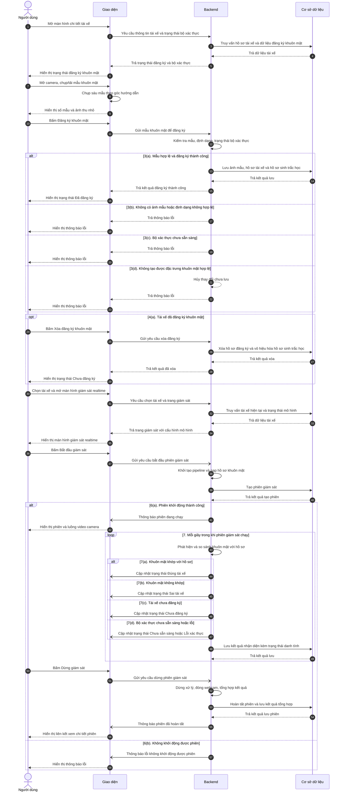

# SRS Draft - Xác thực khuôn mặt

> Draft nội bộ được sinh từ `business_flow_xac-thuc-khuon-mat.json` (schema 3.0).
> Chế độ tài liệu: `as_is`. Số hiệu mục: bắt đầu từ `3.1.1`.

## 3. THIẾT KẾ CHI TIẾT

### 3.1 Giám sát an toàn tài xế

### 3.1.1 Xác thực khuôn mặt

#### 3.1.1.1 Thông tin chung chức năng

Chức năng Xác thực khuôn mặt cho phép ghi nhận bộ mẫu khuôn mặt của một tài xế một lần, sau đó dùng dữ liệu này để xác thực danh tính người lái theo thời gian thực trong suốt phiên giám sát an toàn tài xế. Người dùng khởi tạo việc đăng ký, xóa đăng ký và bắt đầu/dừng phiên giám sát; hệ thống tự động so khớp khuôn mặt mỗi giây và hiển thị trạng thái danh tính (Đúng tài xế, Sai tài xế, Chưa đăng ký, Chưa sẵn sàng hoặc Lỗi xác thực). Kết quả chính của chức năng là hồ sơ đăng ký khuôn mặt được lưu cho tài xế và trạng thái danh tính được cập nhật, lưu kèm theo từng bản ghi nhận diện của phiên.

#### 3.1.1.2 Màn hình

[Hình ảnh màn hình được bổ sung]

Chức năng sử dụng hai màn hình: màn hình Chi tiết tài xế (panel Đăng ký khuôn mặt) và màn hình Giám sát realtime an toàn tài xế (mục Xác thực danh tính).

#### 3.1.1.3 Mô tả chi tiết các thành phần

Bảng dưới đây mô tả các thành phần chính của panel Đăng ký khuôn mặt trên màn hình Chi tiết tài xế và mục Xác thực danh tính trên màn hình Giám sát realtime.

| STT | Tên | Kiểu dữ liệu | Input/Output | Giá trị khởi tạo | Mô tả |
|---|---|---|---|---|---|
| 1 | Trạng thái bộ xác thực khuôn mặt | Badge | Output | null | Hiển thị mức sẵn sàng của bộ xác thực khuôn mặt (sẵn sàng hoặc chưa sẵn sàng). Khi chưa sẵn sàng, việc đăng ký bị vô hiệu hóa cho đến khi có đủ mô hình và runtime. |
| 2 | Trạng thái đăng ký khuôn mặt | Badge | Output | Chưa đăng ký | Hiển thị trạng thái Đã đăng ký hoặc Chưa đăng ký của tài xế. Chuyển sang Đã đăng ký khi hồ sơ khuôn mặt được lưu thành công. |
| 3 | Ngưỡng khớp | Label | Output | 0.94 | Hiển thị ngưỡng khoảng cách đặc trưng dùng để kết luận khớp hay không khớp trong xác thực danh tính. |
| 4 | Khung camera đăng ký | Video | Input/Output | null | Hiển thị luồng camera khi người dùng bấm Mở camera. Khi không mở được camera, hiển thị thông báo và cho phép dùng cách tải ảnh lên thay thế. |
| 5 | Nút Mở camera | Button | Input | null | Mở camera trong khung đăng ký để chụp mẫu khuôn mặt theo hướng dẫn. |
| 6 | Nút Chụp mẫu theo hướng dẫn | Button | Input | null | Chụp tự động sáu mẫu khuôn mặt theo các góc hướng dẫn: nhìn thẳng, quay nhẹ sang trái, quay nhẹ sang phải, ngẩng mặt nhẹ, cúi mặt nhẹ, nhìn thẳng lại và giữ yên. |
| 7 | Nút Dừng camera | Button | Input | null | Dừng camera và đóng luồng video trong khung đăng ký. |
| 8 | Số mẫu đã chụp | Label | Output | 0 | Hiển thị số lượng mẫu khuôn mặt đã chụp trong lần đăng ký hiện tại. |
| 9 | Danh sách ảnh thu nhỏ | List | Output | null | Hiển thị các mẫu khuôn mặt đã chụp hoặc đã tải lên dưới dạng ảnh thu nhỏ để người dùng kiểm tra trước khi đăng ký. |
| 10 | Tải ảnh khuôn mặt lên | Upload | Input | null | Cho phép chọn ảnh khuôn mặt định dạng jpg, jpeg, png hoặc webp. Dùng thay thế khi camera không hoạt động; các ảnh này được gộp chung với mẫu chụp từ camera, tối đa mười hai ảnh cho một lần đăng ký. |
| 11 | Nút Đăng ký khuôn mặt | Button | Input | null | Gửi các mẫu khuôn mặt để hệ thống kiểm tra, trích xuất đặc trưng và lưu hồ sơ đăng ký cho tài xế. Không thực hiện khi không có ảnh mẫu hợp lệ, định dạng không được phép, bộ xác thực chưa sẵn sàng hoặc không tạo được đặc trưng hợp lệ. |
| 12 | Nút Xóa đăng ký khuôn mặt | Button | Input | null | Chỉ xuất hiện khi tài xế đã đăng ký khuôn mặt. Xóa hồ sơ đăng ký khuôn mặt khỏi tài xế, vô hiệu hóa hồ sơ sinh trắc học và xóa tệp ảnh đăng ký nếu có. |
| 13 | Mục Xác thực danh tính | Badge | Output | Chưa sẵn sàng | Hiển thị trạng thái danh tính hiện tại trong phiên giám sát realtime: Đang xác thực, Đúng tài xế, Sai tài xế, Chưa đăng ký, Chưa sẵn sàng hoặc Lỗi xác thực. |
| 14 | Nút Bắt đầu giám sát | Button | Input | null | Khởi động phiên giám sát realtime: mở camera, nạp hồ sơ khuôn mặt đã đăng ký của tài xế hiện tại và bắt đầu vòng lặp xác thực danh tính. |
| 15 | Nút Dừng giám sát | Button | Input | null | Dừng phiên giám sát, đóng camera, tổng hợp kết quả và hoàn tất lưu phiên kèm trạng thái danh tính cuối. |
| 16 | Luồng video camera | Image | Output | null | Hiển thị luồng video trực tiếp từ camera trong phiên giám sát. |
| 17 | Liên kết Xem phiên đã lưu | Link | Output | null | Hiển thị sau khi phiên hoàn tất; mở trang chi tiết phiên chứa kết quả tổng hợp và trạng thái danh tính. |

#### 3.1.1.4 Luồng nghiệp vụ

##### 3.1.1.4.1 Sơ đồ luồng nghiệp vụ

##### 3.1.1.4.2 Mô tả luồng xử lý

(1) Kiểm tra hồ sơ tài xế và trạng thái bộ xác thực khuôn mặt. Người dùng mở màn hình chi tiết tài xế. Hệ thống truy vấn hồ sơ tài xế và dữ liệu đăng ký khuôn mặt, đồng thời kiểm tra trạng thái sẵn sàng của bộ xác thực. Màn hình hiển thị trạng thái đăng ký khuôn mặt (đã đăng ký hoặc chưa đăng ký), ngưỡng khớp và trạng thái bộ xác thực.

(2) Thu thập mẫu khuôn mặt. Người dùng mở camera và chụp mẫu theo hướng dẫn các góc hoặc tải ảnh khuôn mặt lên. Giao diện hiển thị số mẫu đã chụp và ảnh thu nhỏ. Mẫu chụp từ camera và ảnh tải lên có thể được gộp chung, tối đa mười hai ảnh cho một lần đăng ký.

(3) Đăng ký khuôn mặt cho tài xế. Người dùng bấm Đăng ký khuôn mặt. Hệ thống kiểm tra có ảnh mẫu, định dạng cho phép và trạng thái bộ xác thực; với từng ảnh hợp lệ, định vị khuôn mặt, trích xuất đặc trưng và lưu ảnh mẫu, sau đó gộp thành đặc trưng đại diện và lưu hồ sơ đăng ký kèm ngưỡng khớp 0.94. Ảnh không đọc được hoặc không phát hiện khuôn mặt bị bỏ qua và được thống kê.

- TH1: Mẫu hợp lệ và đăng ký thành công. Hồ sơ đăng ký khuôn mặt của tài xế được lưu và hiển thị trạng thái Đã đăng ký.
- TH2: Không có ảnh mẫu hoặc định dạng không hợp lệ. Đăng ký không được thực hiện, hiển thị thông báo lỗi.
- TH3: Bộ xác thực chưa sẵn sàng. Đăng ký không được thực hiện, hiển thị thông báo lỗi.
- TH4: Không tạo được đặc trưng khuôn mặt hợp lệ. Hệ thống hủy các thay đổi chưa lưu, đăng ký không được thực hiện.

(4) Xóa đăng ký khuôn mặt. Nếu tài xế đã có hồ sơ đăng ký khuôn mặt, người dùng có thể bấm Xóa đăng ký khuôn mặt. Hệ thống xóa hồ sơ đăng ký khỏi tài xế, vô hiệu hóa hồ sơ sinh trắc học, xóa tệp ảnh đăng ký nếu có và ghi nhật ký. Màn hình hiển thị trạng thái Chưa đăng ký.

(5) Chọn tài xế và mở màn hình giám sát realtime. Người dùng chọn tài xế làm tài xế hiện tại, sau đó mở màn hình giám sát realtime. Hệ thống lưu tài xế hiện tại vào phiên làm việc và truy vấn cấu hình cùng trạng thái mô hình. Màn hình giám sát hiển thị tài xế hiện tại và mục trạng thái xác thực danh tính.

(6) Bắt đầu phiên giám sát realtime. Người dùng bấm Bắt đầu giám sát. Hệ thống kiểm tra tài xế hiện tại, khởi tạo pipeline, nạp hồ sơ khuôn mặt đã đăng ký và tạo phiên giám sát.

- TH1: Phiên khởi động thành công. Trạng thái danh tính khởi tạo là Đang xác thực nếu có hồ sơ đăng ký và bộ xác thực sẵn sàng; Chưa đăng ký nếu tài xế chưa đăng ký; Chưa sẵn sàng nếu bộ xác thực không khả dụng. Màn hình hiển thị phiên đang chạy và luồng video camera.
- TH2: Không khởi động được phiên. Hệ thống thông báo lỗi và không tạo phiên.

(7) Xác thực danh tính khuôn mặt trong thời gian thực. Trong suốt phiên giám sát, hệ thống mỗi giây phát hiện khuôn mặt, trích xuất đặc trưng và so sánh với hồ sơ đã đăng ký, đồng thời lưu kết quả nhận diện kèm trạng thái danh tính vào phiên.

- TH1: Khuôn mặt khớp với hồ sơ đã đăng ký (khoảng cách đặc trưng không vượt ngưỡng 0.94). Hiển thị trạng thái Đúng tài xế.
- TH2: Khuôn mặt không khớp với hồ sơ đã đăng ký. Hiển thị trạng thái Sai tài xế.
- TH3: Tài xế chưa đăng ký khuôn mặt. Hiển thị trạng thái Chưa đăng ký.
- TH4: Bộ xác thực chưa sẵn sàng hoặc lỗi xác thực. Hiển thị trạng thái Chưa sẵn sàng hoặc Lỗi xác thực.

(8) Kết thúc phiên giám sát realtime. Người dùng bấm Dừng giám sát. Hệ thống dừng vòng lặp xử lý, đóng webcam, tổng hợp kết quả và lưu phiên hoàn tất kèm trạng thái danh tính cuối cùng. Màn hình hiển thị phiên đã hoàn tất và liên kết xem chi tiết phiên.

## Ghi chú

- Nguồn tài liệu `README.md` có ghi chú cũ cho biết luồng đăng ký/so khớp khuôn mặt chưa được tích hợp vào runtime; tuy nhiên source hiện tại đã tích hợp đầy đủ luồng đăng ký (route đăng ký/xóa trên màn hình Chi tiết tài xế) và xác thực danh tính realtime (pipeline an toàn tài xế). Tài liệu này mô tả theo hành vi thực tế của source hiện tại.
- Bước (3), (6) và (7) có nhiều nhánh kết quả loại trừ nhau; mô tả được thể hiện bằng các mục TH tương ứng.
