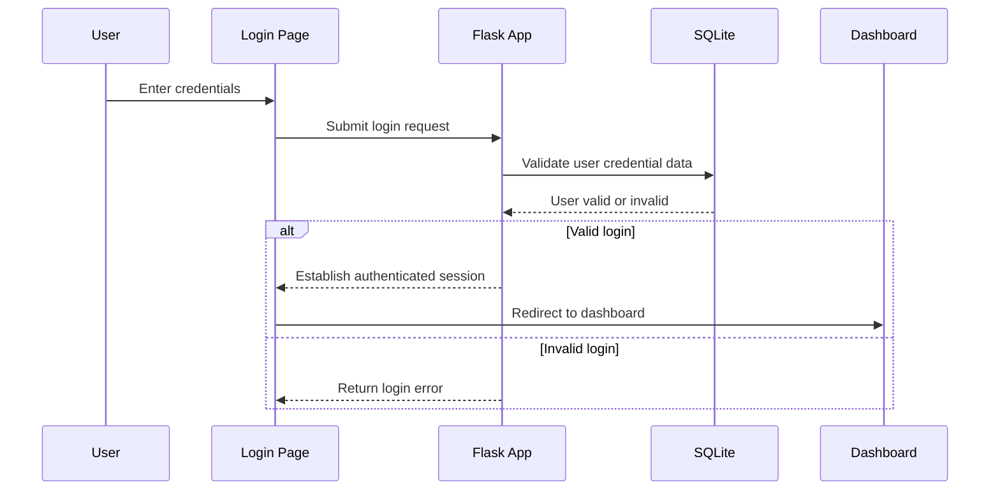
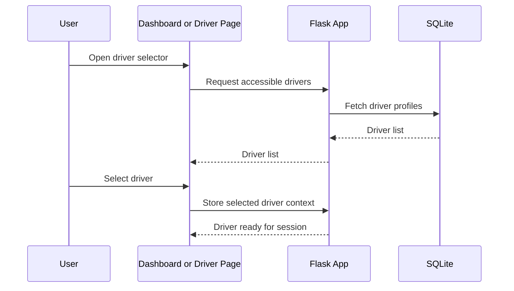
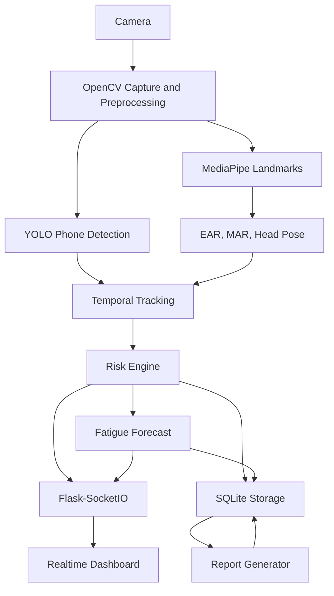
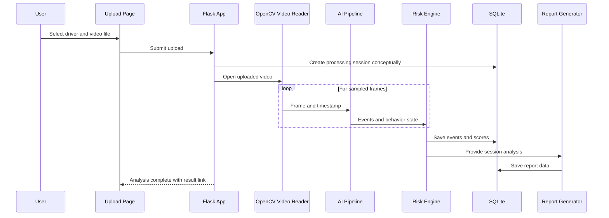
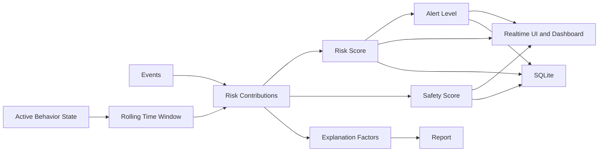

# AI Driver Safety Assessment System - Data Flow Specification

## 1. Purpose

This document defines how data moves through the AI Driver Safety Assessment System. It covers user authentication, multi-driver selection, realtime webcam monitoring, video upload analysis, AI processing, risk scoring, report generation, dashboard display, and history storage.

This document does not define source code, SQL schema, or project structure.

## 2. Data Flow Principles

- Every analysis session must be associated with an authenticated user and one driver profile.
- Realtime webcam sessions and uploaded video sessions must produce the same conceptual result structure.
- Frame-level signals should be reduced into temporal events before being stored.
- Dashboard, history, and reports should read from stored session results rather than recomputing analysis.
- Realtime updates should be compact and suitable for browser display.
- Raw video frames should not be stored by default.
- All persistent application data should remain local in SQLite.

## 3. Main Data Domains

### 3.1 Authentication Data

Data examples:

- username or login identifier
- password verification data
- active login session state
- authenticated user identifier

Flow:

```text
Login form
  -> Flask authentication handler
  -> SQLite user data validation
  -> authenticated browser session
  -> protected dashboard access
```

### 3.2 Driver Data

Data examples:

- driver identifier
- driver display name
- optional driver description
- user ownership or access context

Flow:

```text
Driver page or dashboard
  -> Flask driver handler
  -> SQLite driver records
  -> selected driver context
  -> realtime or uploaded video session
```

### 3.3 Session Data

Data examples:

- session identifier
- user identifier
- driver identifier
- session type
- status
- start time
- end time
- duration
- final safety score
- final risk summary

Flow:

```text
Start realtime or upload analysis
  -> create session context
  -> process media input
  -> generate events, scores, forecast, report
  -> store session result
  -> display in dashboard/history/report pages
```

### 3.4 AI Signal Data

Data examples:

- frame timestamp
- face detected flag
- landmark coordinates
- EAR value
- MAR value
- head pose category
- phone detection confidence
- behavior candidate flags

Flow:

```text
Video frame
  -> OpenCV preprocessing
  -> MediaPipe and YOLO analysis
  -> behavior signal extraction
  -> temporal tracking
  -> confirmed events
```

AI signal data is mostly transient. It should be stored only when summarized into events, scores, explanations, or optional snapshots.

### 3.5 Event Data

Data examples:

- event type
- event start timestamp
- event end timestamp
- duration
- severity
- confidence where available
- explanation

Flow:

```text
Frame-level behavior signals
  -> temporal tracker
  -> confirmed event
  -> risk engine
  -> event timeline
  -> SQLite storage
  -> dashboard/history/report display
```

### 3.6 Score Data

Data examples:

- rolling risk score
- final risk score
- final safety score
- alert level
- risk category breakdown
- score timeline points

Flow:

```text
Confirmed events and active signals
  -> risk engine
  -> rolling risk state
  -> realtime UI updates
  -> final score calculation
  -> SQLite storage
  -> dashboard and reports
```

### 3.7 Forecast Data

Data examples:

- fatigue trend label
- recent fatigue indicators
- forecast explanation
- confidence where available

Flow:

```text
Drowsiness-related events and risk trend
  -> fatigue forecast component
  -> trend result
  -> report and dashboard
  -> SQLite storage
```

### 3.8 Report Data

Data examples:

- session summary
- safety score explanation
- key risk factors
- timeline summary
- fatigue forecast explanation
- recommendations
- limitations

Flow:

```text
Stored session result
  -> report generator
  -> report content
  -> SQLite storage
  -> reports page
```

## 4. Login Data Flow



Data exchanged:

- login identifier
- password input
- validation result
- authenticated session state

Persistent data touched:

- user account data

Outputs:

- dashboard access when valid
- error message when invalid

## 5. Driver Selection Data Flow



Data exchanged:

- authenticated user identifier
- driver list
- selected driver identifier

Persistent data touched:

- driver data

Outputs:

- active driver context for realtime or upload workflow

## 6. Realtime Webcam Monitoring Data Flow

### 6.1 Required Flow

```text
Camera
  -> Processing
  -> SocketIO
  -> Dashboard
```

Expanded flow:

```text
Camera
  -> OpenCV capture
  -> frame preprocessing
  -> MediaPipe face landmarks
  -> YOLO phone detection
  -> EAR/MAR/head pose calculations
  -> temporal tracking
  -> risk engine
  -> fatigue forecast update
  -> Flask-SocketIO event emission
  -> realtime dashboard display
  -> final session storage
```

### 6.2 Realtime Data Flow Diagram



### 6.3 Realtime Start Data

Input data:

- authenticated user identifier
- selected driver identifier
- session type: realtime
- optional monitoring settings

Internal actions:

- create active session context
- initialize camera capture
- initialize AI pipeline
- initialize temporal trackers
- initialize risk engine
- initialize empty timeline

Output data:

- active session identifier
- processing status
- initial alert level

### 6.4 Realtime Frame Data

For each processed frame:

- frame timestamp
- frame dimensions or processing metadata
- face detected status
- landmarks if available
- phone detections if available
- EAR value if available
- MAR value if available
- head pose category if available
- behavior candidate flags

Frame data moves through the AI pipeline and should be summarized before storage.

### 6.5 Realtime SocketIO Update Data

Each realtime update should contain compact display data:

- session identifier
- elapsed time
- current risk score
- current safety estimate
- current alert level
- active behavior states
- latest confirmed event if any
- fatigue trend status
- warning message if any
- processing status

The browser should use these updates to refresh:

- risk score display
- alert badge
- active event indicators
- timeline list
- chart data
- warnings

### 6.6 Realtime Stop Data

Input data:

- stop command
- session identifier
- authenticated user context

Internal actions:

- release camera
- close active events
- finalize risk score
- calculate final safety score
- generate fatigue forecast summary
- generate report
- store session history

Output data:

- final session summary
- final safety score
- final alert summary
- report available status
- saved history status

## 7. Video Upload Analysis Data Flow

### 7.1 Upload Flow



### 7.2 Upload Input Data

- authenticated user identifier
- selected driver identifier
- uploaded video file
- original filename metadata
- upload time
- optional analysis settings

### 7.3 Upload Processing Data

- video duration
- frame timestamps
- sampled frames
- AI signal data
- temporal events
- risk score series
- final session score

### 7.4 Upload Output Data

- analysis status
- session summary
- event timeline
- safety score
- fatigue forecast
- report link or report content
- dashboard update availability

### 7.5 Upload Failure Data

Possible failure states:

- invalid file type
- unreadable video
- no frames available
- no driver selected
- analysis interrupted
- AI model unavailable

Expected output:

- clear user-facing error
- failed or canceled session status where applicable
- no misleading final report

## 8. AI Pipeline Data Flow

### 8.1 OpenCV Data Flow

Input:

- camera stream or video file

Processing:

- capture frame
- assign timestamp
- resize frame
- prepare color format
- pass frame to analysis components

Output:

- processed frame
- timestamp
- frame metadata

### 8.2 MediaPipe Data Flow

Input:

- processed frame

Processing:

- detect face landmarks
- identify eye landmarks
- identify mouth landmarks
- identify head pose reference points

Output:

- face detected status
- eye landmark data
- mouth landmark data
- head reference points
- landmark quality status

### 8.3 YOLO Data Flow

Input:

- processed frame

Processing:

- detect object classes
- filter for phone class or phone-like target class
- calculate confidence and location

Output:

- phone detected flag
- detection confidence
- bounding box

### 8.4 EAR Data Flow

Input:

- eye landmark data

Processing:

- calculate eye aspect ratio
- classify eye open or closed

Output:

- EAR value
- eye closed flag
- possible prolonged closure candidate

### 8.5 MAR Data Flow

Input:

- mouth landmark data

Processing:

- calculate mouth aspect ratio
- classify yawn candidate

Output:

- MAR value
- yawn candidate flag

### 8.6 Head Pose Data Flow

Input:

- face landmarks and reference points

Processing:

- estimate driver head direction
- classify forward or non-forward attention

Output:

- head pose category
- distraction candidate flag

### 8.7 Temporal Tracking Data Flow

Input:

- eye closed flag
- yawn candidate flag
- distraction candidate flag
- phone detected flag
- face missing flag
- timestamps

Processing:

- smooth signals
- apply minimum duration rules
- merge related detections
- produce event boundaries
- assign severity

Output:

- confirmed events
- active event state
- event evidence

### 8.8 Risk Engine Data Flow

Input:

- confirmed events
- active event state
- recent behavior history
- elapsed session time

Processing:

- calculate rolling risk
- update alert level
- update safety estimate
- calculate category contribution

Output:

- current risk score
- current safety estimate
- alert level
- explanation factors
- final safety score at session end

### 8.9 Fatigue Forecast Data Flow

Input:

- drowsiness events
- yawn frequency
- eye closure trend
- recent risk score trend

Processing:

- identify stable, increasing, or decreasing fatigue pattern
- create forecast explanation

Output:

- fatigue trend label
- forecast explanation
- optional confidence

## 9. Event Timeline Data Flow

Timeline creation:

```text
Behavior signal starts
  -> temporal tracker opens candidate event
  -> signal lasts long enough
  -> confirmed event is emitted
  -> risk engine updates score
  -> realtime UI receives event
  -> event is stored
  -> history and report can display event later
```

Timeline event data:

- event type
- start timestamp
- end timestamp
- duration
- severity
- explanation
- related risk contribution

Timeline consumers:

- realtime page
- session detail page
- history page
- report generator
- dashboard charts

## 10. Risk and Safety Score Data Flow



Risk score data:

- changes over time
- supports realtime display and trend charts
- reflects current or recent risk intensity

Safety score data:

- finalized at session end
- supports dashboard comparison
- easier for users to interpret than raw risk

Alert level data:

- derived from current risk and event severity
- supports immediate display in realtime mode
- summarized in the report

## 11. Report Generation Data Flow

```text
Completed session
  -> retrieve session metadata
  -> retrieve event timeline
  -> retrieve score summary
  -> retrieve risk explanations
  -> retrieve fatigue forecast
  -> generate report sections
  -> store report data
  -> display on reports page
```

Report input data:

- driver information
- session metadata
- safety score
- risk score summary
- event timeline
- dominant risk factors
- fatigue forecast
- limitations

Report output data:

- report title and session summary
- safety assessment summary
- key risk explanations
- event timeline summary
- fatigue trend forecast explanation
- recommendation text
- limitations text

## 12. Dashboard Data Flow

### 12.1 Dashboard Home

Input:

- authenticated user context
- selected or accessible driver profiles
- stored sessions and events

Processing:

- aggregate recent sessions
- calculate average safety score
- count risk event types
- prepare trend chart data

Output:

- summary cards
- charts
- recent session list
- high-risk highlights

### 12.2 Realtime Page

Input:

- selected driver
- SocketIO live updates

Output:

- live risk state
- current alert level
- active event list
- timeline updates
- final session result

### 12.3 History Page

Input:

- driver filter
- date filter where supported
- stored sessions

Output:

- session list
- safety score summaries
- risk category summaries
- links to session details and reports

### 12.4 Reports Page

Input:

- selected session or report identifier
- stored report content

Output:

- readable AI driving report
- timeline summary
- fatigue forecast
- risk explanation

### 12.5 Driver Page

Input:

- authenticated user context
- driver form data

Output:

- driver list
- driver profile detail
- selected driver context

## 13. Persistent Storage Data Flow

Write events:

- successful login may update session-related metadata if needed
- driver creation or update stores driver data
- session start creates session context conceptually
- confirmed events store timeline data
- session end stores final scores
- report generation stores report data

Read events:

- dashboard reads aggregate session and event data
- history reads session list and summaries
- reports page reads report data
- realtime page reads driver data and writes active session results
- upload page reads selected driver context and writes processing results

Data retention:

- keep all required history for demo and evaluation
- avoid storing raw frames by default
- optional event snapshots may be stored if explicitly implemented later

## 14. Data Flow Validation Checklist

Before implementation, each workflow should satisfy these checks:

- A session cannot start without an authenticated user.
- A session cannot start without a selected driver.
- Realtime and upload workflows produce compatible session result data.
- Events include timestamps and event types.
- Risk scores can be shown over time.
- Safety score can be shown in dashboard and history.
- Fatigue forecast can be included in reports.
- Report generation can run from stored session results.
- Dashboard can be loaded without rerunning video analysis.
- Failure states produce clear UI feedback.

