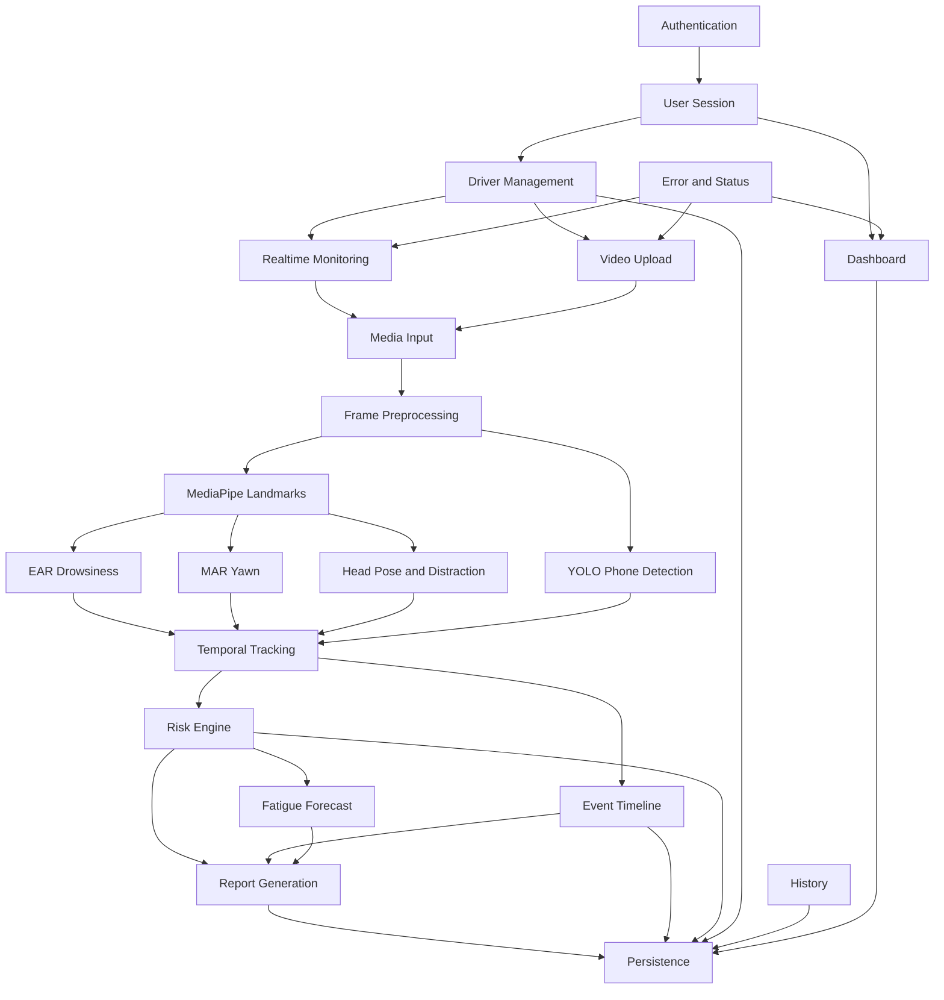

# AI Driver Safety Assessment System - Module Specification

## 1. Purpose

This document defines the responsibilities, inputs, outputs, and dependencies of each major module in the AI Driver Safety Assessment System. It is intended to make implementation ready to begin after architecture approval.

This document does not define source code, SQL schema, or project structure.

## 2. Module Overview

The system is divided into the following conceptual modules:

- Authentication Module
- User Session Module
- Driver Management Module
- Dashboard Module
- Realtime Monitoring Module
- Video Upload Module
- Media Input Module
- Frame Preprocessing Module
- MediaPipe Landmark Module
- YOLO Phone Detection Module
- EAR Drowsiness Module
- MAR Yawn Module
- Head Pose and Distraction Module
- Temporal Tracking Module
- Risk Engine Module
- Fatigue Forecast Module
- Event Timeline Module
- Report Generation Module
- History Module
- Persistence Module
- Error and Status Module
- Evaluation Support Module

Each module should have a clear boundary so that development can proceed incrementally.

## 3. Authentication Module

### Purpose

Provide login protection for the application and prevent unauthenticated access to driver data, monitoring, uploads, history, dashboard, and reports.

### Inputs

- login identifier
- password input
- browser session data

### Outputs

- authenticated user context
- login success or failure result
- logout result
- access allowed or denied decision

### Dependencies

- Flask
- SQLite persistence
- user session handling

### Responsibilities

- Validate login credentials.
- Establish authenticated browser session.
- Protect application routes that require login.
- Provide logout behavior.
- Expose authenticated user identity to other modules.

### Notes

- Authentication should remain simple and local.
- No external identity provider is required.
- No paid authentication service is allowed.

## 4. User Session Module

### Purpose

Maintain browser-level user state after login and provide current user context to other modules.

### Inputs

- authentication result
- browser session data
- logout request

### Outputs

- current user identifier
- authenticated state
- cleared session state after logout

### Dependencies

- Flask session support
- Authentication Module

### Responsibilities

- Track whether the current browser user is logged in.
- Provide authenticated user context to driver, dashboard, realtime, upload, history, and report modules.
- Clear session state on logout.

## 5. Driver Management Module

### Purpose

Support multi-driver usage by creating, selecting, viewing, and updating driver profiles.

### Inputs

- authenticated user context
- driver profile form data
- selected driver identifier

### Outputs

- driver list
- driver detail
- selected driver context
- driver creation or update result

### Dependencies

- Flask
- SQLite persistence
- Authentication Module

### Responsibilities

- Create driver profiles.
- Retrieve drivers accessible to the authenticated user.
- Update basic driver information.
- Provide driver selection for realtime and upload sessions.
- Ensure each analysis session can be associated with a driver.

### Stored Information Conceptually

- driver identity
- driver display name
- optional metadata
- user ownership or access relationship

## 6. Dashboard Module

### Purpose

Provide the main overview interface for safety status, recent sessions, driver summaries, risk trends, and navigation to key workflows.

### Inputs

- authenticated user context
- selected driver context
- stored sessions
- stored events
- stored scores
- stored forecast and report summaries

### Outputs

- dashboard summary cards
- recent session list
- safety score trend data
- risk category breakdown
- high-risk session highlights
- navigation options

### Dependencies

- Flask
- HTML/CSS/JavaScript
- Persistence Module
- History Module
- Event Timeline Module

### Responsibilities

- Display recent safety score data.
- Display session history summary.
- Display risk category counts.
- Display safety or risk trend chart data.
- Provide access to realtime monitoring, video upload, history, drivers, and reports.

## 7. Realtime Monitoring Module

### Purpose

Coordinate webcam-based live monitoring and deliver realtime analysis updates to the browser.

### Inputs

- authenticated user context
- selected driver identifier
- start monitoring command
- stop monitoring command
- webcam frames from Media Input Module

### Outputs

- active session identifier
- realtime risk updates
- current alert level
- current safety estimate
- active behavior states
- timeline event updates
- warning messages
- final session summary

### Dependencies

- Flask-SocketIO
- Media Input Module
- AI processing modules
- Risk Engine Module
- Fatigue Forecast Module
- Event Timeline Module
- Persistence Module
- Report Generation Module

### Responsibilities

- Start a realtime monitoring session.
- Validate that user and driver context exist.
- Open webcam stream through the media input module.
- Run frames through the AI pipeline.
- Emit compact realtime updates through SocketIO.
- Stop monitoring on user request.
- Finalize scores, events, forecast, report, and history.
- Handle camera unavailable or camera failure cases.

## 8. Video Upload Module

### Purpose

Support uploaded video analysis using the same AI pipeline as realtime monitoring.

### Inputs

- authenticated user context
- selected driver identifier
- uploaded video file
- upload metadata

### Outputs

- upload validation result
- processing status
- completed session result
- event timeline
- safety score
- fatigue forecast
- report availability
- failure message if analysis cannot complete

### Dependencies

- Flask
- OpenCV through Media Input Module
- AI processing modules
- Risk Engine Module
- Fatigue Forecast Module
- Persistence Module
- Report Generation Module

### Responsibilities

- Validate upload request.
- Associate upload with driver and user.
- Open uploaded video through OpenCV.
- Process sampled frames.
- Generate events and scores.
- Store completed analysis results.
- Return result or status to UI.

## 9. Media Input Module

### Purpose

Provide a unified source of frames for webcam and uploaded video workflows.

### Inputs

- camera source request
- uploaded video file path or video reference
- processing configuration such as frame sampling rate

### Outputs

- frame image data
- frame timestamp
- frame index or sequence information
- media status
- end-of-stream signal
- media error signal

### Dependencies

- OpenCV

### Responsibilities

- Open webcam source.
- Open uploaded video source.
- Read frames.
- Provide timestamps.
- Release media resources.
- Report media errors.
- Support frame sampling if needed for performance.

### Notes

- This module should hide the difference between webcam frames and uploaded video frames from the downstream AI pipeline as much as possible.

## 10. Frame Preprocessing Module

### Purpose

Prepare raw frames for MediaPipe, YOLO, and display-oriented processing.

### Inputs

- raw frame
- frame timestamp
- target processing settings

### Outputs

- resized or normalized frame
- color-converted frame where needed
- frame metadata

### Dependencies

- OpenCV

### Responsibilities

- Resize frames for efficient processing.
- Convert color format for model requirements.
- Preserve timestamp metadata.
- Provide consistent frame dimensions to AI modules where possible.

## 11. MediaPipe Landmark Module

### Purpose

Extract face landmarks required for EAR, MAR, and head pose analysis.

### Inputs

- preprocessed frame

### Outputs

- face detected flag
- face landmark coordinates
- eye landmark coordinates
- mouth landmark coordinates
- head pose reference landmarks
- landmark quality status

### Dependencies

- MediaPipe
- Frame Preprocessing Module

### Responsibilities

- Run face landmark detection.
- Identify required eye, mouth, and face reference points.
- Report failure or low-confidence detection.
- Provide landmark data to drowsiness, yawn, and head pose modules.

## 12. YOLO Phone Detection Module

### Purpose

Detect phone presence in frames as evidence of phone usage risk.

### Inputs

- preprocessed frame
- model configuration

### Outputs

- phone detected flag
- detection confidence
- phone bounding box
- detection metadata

### Dependencies

- YOLO11n or YOLO11s
- OpenCV-compatible frame data
- Frame Preprocessing Module

### Responsibilities

- Load the selected lightweight YOLO model.
- Run object detection on sampled frames.
- Filter detections for phone class or configured phone target.
- Provide confidence and location data.
- Report model loading or inference errors.

### Notes

- YOLO11n should be preferred when realtime performance is the priority.
- YOLO11s may be used when accuracy is more important and performance remains acceptable.

## 13. EAR Drowsiness Module

### Purpose

Detect eye closure indicators using eye aspect ratio.

### Inputs

- eye landmark coordinates
- frame timestamp
- landmark quality status

### Outputs

- EAR value
- eye closed flag
- eye closure quality status
- drowsiness candidate signal

### Dependencies

- MediaPipe Landmark Module

### Responsibilities

- Calculate EAR from eye landmarks.
- Compare EAR to configured threshold.
- Mark eye closure candidate states.
- Avoid producing confident output when landmarks are missing or unreliable.
- Send eye closure signals to Temporal Tracking Module.

### Notes

- Brief blinks should not become drowsiness events directly.
- Temporal Tracking Module is responsible for confirming prolonged eye closure.

## 14. MAR Yawn Module

### Purpose

Detect yawning indicators using mouth aspect ratio.

### Inputs

- mouth landmark coordinates
- frame timestamp
- landmark quality status

### Outputs

- MAR value
- yawn candidate flag
- yawn quality status

### Dependencies

- MediaPipe Landmark Module

### Responsibilities

- Calculate MAR from mouth landmarks.
- Compare MAR to configured threshold.
- Produce yawn candidate signal.
- Avoid confident output when mouth landmarks are missing or unreliable.
- Send yawn signals to Temporal Tracking Module.

### Notes

- Open mouth in a single frame should not be treated as a confirmed yawn.
- Temporal Tracking Module is responsible for confirming yawn duration.

## 15. Head Pose and Distraction Module

### Purpose

Estimate driver attention direction and detect distraction candidates.

### Inputs

- face landmarks
- head pose reference landmarks
- frame timestamp
- landmark quality status

### Outputs

- head pose estimate
- attention direction category
- distraction candidate flag
- face missing or unreliable face status

### Dependencies

- MediaPipe Landmark Module
- OpenCV mathematical utilities where needed

### Responsibilities

- Estimate whether the driver is facing forward, left, right, up, down, or unknown.
- Identify non-forward attention states.
- Provide distraction candidate signals to Temporal Tracking Module.
- Report low-confidence or missing-face conditions.

### Notes

- Short glances should not immediately become distraction events.
- Sustained or repeated non-forward attention should contribute to distraction risk.

## 16. Temporal Tracking Module

### Purpose

Convert noisy frame-level AI signals into stable, timestamped events.

### Inputs

- eye closure candidate signals
- yawn candidate signals
- distraction candidate signals
- phone detected signals
- face missing signals
- timestamps
- confidence values where available

### Outputs

- confirmed drowsiness events
- confirmed yawn events
- confirmed distraction events
- confirmed phone usage events
- active event state
- event start and end timestamps
- event duration
- event severity
- event evidence summary

### Dependencies

- EAR Drowsiness Module
- MAR Yawn Module
- Head Pose and Distraction Module
- YOLO Phone Detection Module

### Responsibilities

- Smooth frame-level signals.
- Apply minimum duration requirements.
- Merge nearby repeated detections when appropriate.
- Close active events when signals end.
- Assign severity based on event duration, frequency, or confidence.
- Forward confirmed events to Risk Engine and Event Timeline modules.

## 17. Risk Engine Module

### Purpose

Calculate temporal risk score, safety score, alert level, and explainable risk factors.

### Inputs

- confirmed events
- active event states
- event type
- event duration
- event severity
- event frequency
- confidence values where available
- session elapsed time

### Outputs

- current risk score
- score timeline data
- estimated current safety score
- final safety score
- alert level
- category risk breakdown
- dominant risk factors
- explanation items

### Dependencies

- Temporal Tracking Module
- Event Timeline Module

### Responsibilities

- Assign risk contribution to drowsiness, distraction, and phone usage.
- Increase risk for longer, repeated, or overlapping events.
- Maintain rolling risk score for realtime display.
- Calculate final session safety score.
- Determine alert level.
- Provide explanation factors for reports and dashboard.

### Required Output Meanings

- **Risk Score**: current or temporal unsafe behavior intensity.
- **Safety Score**: final overall session assessment, easier to compare across sessions.
- **Alert Level**: human-readable current state such as normal, caution, warning, or danger.

## 18. Fatigue Forecast Module

### Purpose

Estimate the trend of fatigue risk from recent drowsiness-related indicators.

### Inputs

- drowsiness events
- yawn events
- EAR trend summary
- eye closure duration and frequency
- recent risk score trend
- session elapsed time

### Outputs

- fatigue trend label
- forecast explanation
- contributing indicators
- optional confidence estimate

### Dependencies

- Risk Engine Module
- Temporal Tracking Module
- EAR Drowsiness Module
- MAR Yawn Module

### Responsibilities

- Determine whether fatigue indicators are increasing, stable, or decreasing.
- Generate explainable forecast output.
- Provide forecast data to dashboard and report generator.

### Notes

- Forecast is an academic and demonstrative feature, not a medical diagnosis.

## 19. Event Timeline Module

### Purpose

Maintain chronological event data for realtime display, session detail, history, and reports.

### Inputs

- confirmed events from Temporal Tracking Module
- risk contribution from Risk Engine Module
- session identifier

### Outputs

- ordered event timeline
- event summary by type
- timeline data for UI
- timeline data for persistence
- timeline data for report generation

### Dependencies

- Temporal Tracking Module
- Risk Engine Module
- Persistence Module

### Responsibilities

- Store event order during active session.
- Provide new event updates for realtime UI.
- Provide complete timeline at session end.
- Support filtering by event type or severity where implemented.

## 20. Report Generation Module

### Purpose

Generate a human-readable AI driving report for each completed session.

### Inputs

- session metadata
- driver data
- event timeline
- final safety score
- risk score summary
- alert level summary
- fatigue forecast
- dominant risk factors
- analysis limitations

### Outputs

- report title
- session summary
- safety score explanation
- key risk analysis
- event timeline summary
- fatigue forecast section
- recommendations
- limitations
- stored report data

### Dependencies

- Risk Engine Module
- Fatigue Forecast Module
- Event Timeline Module
- Persistence Module

### Responsibilities

- Convert analysis data into readable report text.
- Explain why the score was assigned.
- Identify major risk periods.
- Include fatigue forecast interpretation.
- Include practical recommendations.
- Include limitations and non-medical, non-legal scope.

### Notes

- Report generation must be local and must not depend on paid external APIs.

## 21. History Module

### Purpose

Retrieve and present stored driver session history.

### Inputs

- authenticated user context
- selected driver identifier
- optional date or session filters

### Outputs

- session list
- session summaries
- score history
- risk category history
- report links

### Dependencies

- Persistence Module
- Driver Management Module
- Dashboard Module

### Responsibilities

- Fetch previous sessions for a driver.
- Provide summaries for history page.
- Provide data for trend charts.
- Link sessions to reports and timeline details.

## 22. Persistence Module

### Purpose

Provide local SQLite-backed storage and retrieval for all persistent system data.

### Inputs

- user account data
- driver data
- session metadata
- event data
- score data
- forecast data
- report data

### Outputs

- authenticated user records
- driver lists and details
- session records
- timeline records
- dashboard aggregates
- history records
- report records

### Dependencies

- SQLite
- Flask application context where required

### Responsibilities

- Store and retrieve user data.
- Store and retrieve driver profile data.
- Store and retrieve session data.
- Store and retrieve event timeline data.
- Store and retrieve score summaries.
- Store and retrieve fatigue forecast results.
- Store and retrieve report content or report source data.
- Provide data access to dashboard, history, reports, realtime, and upload modules.

### Notes

- This module conceptually owns persistence behavior.
- Actual SQL table definitions are intentionally excluded from this document.

## 23. Error and Status Module

### Purpose

Standardize user-facing status messages, processing states, warnings, and failure handling.

### Inputs

- camera errors
- upload validation errors
- AI model errors
- no-face warnings
- analysis status changes
- database operation results

### Outputs

- user-facing error messages
- processing status values
- warning messages
- failure status for sessions

### Dependencies

- Flask
- Flask-SocketIO
- Realtime Monitoring Module
- Video Upload Module
- AI processing modules

### Responsibilities

- Report missing webcam.
- Report invalid upload.
- Report no face detected.
- Report model unavailable.
- Report analysis failed.
- Report session completed.
- Keep messages understandable for demo users.

## 24. Evaluation Support Module

### Purpose

Support project evaluation and graduation defense by making results measurable and reviewable.

### Inputs

- selected test videos
- realtime demo sessions
- stored events
- stored scores
- expected behavior notes where available

### Outputs

- evaluation summaries
- detection examples
- failure case notes
- latency or processing observations
- risk score comparison data

### Dependencies

- History Module
- Persistence Module
- Dashboard Module
- Report Generation Module

### Responsibilities

- Support evaluation of drowsiness detection.
- Support evaluation of distraction detection.
- Support evaluation of phone usage detection.
- Provide access to examples of correct detections and known failures.
- Provide stored outputs useful for screenshots, tables, and defense slides.

## 25. Module Interaction Summary

## 26. Implementation Priority Guidance

Recommended implementation order after architecture approval:

1. Authentication, user session, and driver management.
2. Persistence access for users, drivers, sessions, events, scores, and reports.
3. Video upload analysis pipeline using OpenCV, MediaPipe, YOLO, temporal tracking, and risk engine.
4. Realtime monitoring with Flask-SocketIO using the same AI pipeline.
5. Dashboard, history, event timeline, and report pages.
6. Fatigue forecast and explainable report refinement.
7. Evaluation support and demo preparation.

This order reduces risk because uploaded video analysis is easier to test repeatedly before realtime monitoring is finalized.

## 27. Readiness Checklist

Implementation can begin when the team accepts:

- The web app is Flask-based.
- Realtime monitoring uses Flask-SocketIO.
- OpenCV is the media input layer.
- MediaPipe provides face landmarks.
- YOLO11n/s provides phone detection.
- EAR, MAR, and head pose provide behavior signals.
- Temporal tracking converts signals into events.
- Risk engine produces risk score, safety score, and alert level.
- SQLite stores conceptual application and analysis data.
- Dashboard and reports read from stored session results.
- No source code, SQL schema, or folder structure has been defined in this document.

