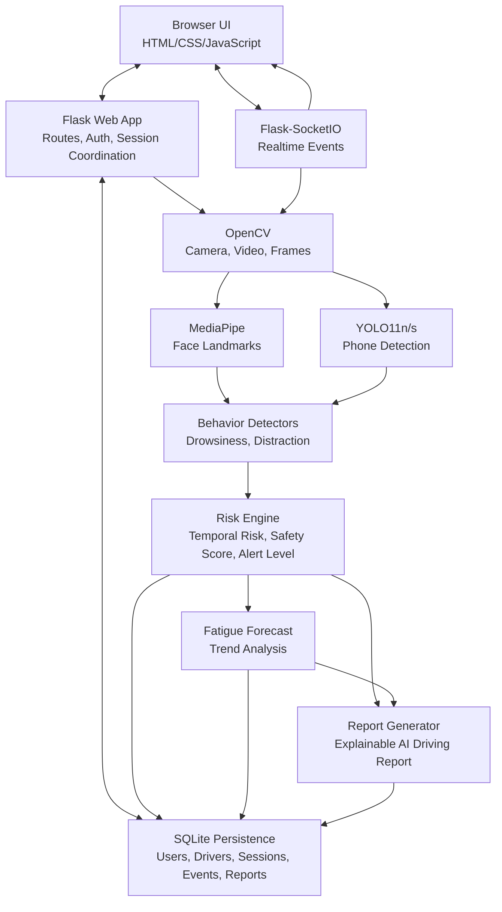
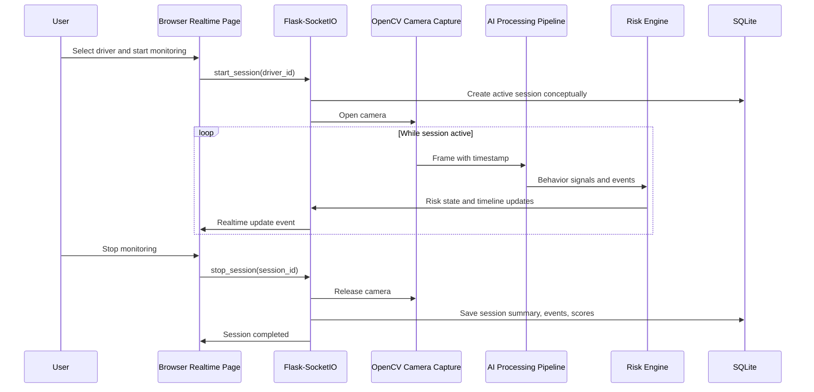
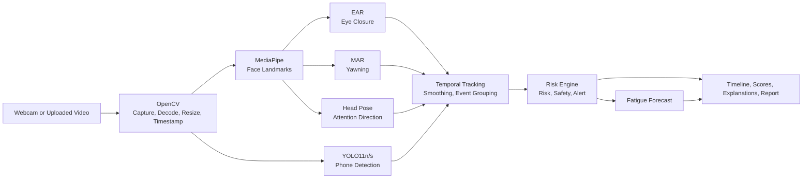

# AI Driver Safety Assessment System - System Architecture Specification

## 1. Purpose

This document defines the complete system architecture for the AI Driver Safety Assessment System. It translates the approved requirements into an implementation-ready architecture while avoiding source code, SQL schema, and project structure decisions.

The architecture is designed for a solo graduation project with a 15-day timeline and must run locally using:

- Flask
- Flask-SocketIO
- HTML, CSS, JavaScript
- SQLite
- OpenCV
- YOLO11n or YOLO11s
- MediaPipe

The system supports login, multi-driver management, realtime webcam monitoring, uploaded video analysis, drowsiness detection, distraction detection, phone usage detection, temporal risk scoring, safety scoring, explainable risk analysis, fatigue trend forecasting, event timelines, driver history, dashboard views, and AI report generation.

## 2. Architecture Goals

- Keep the system small enough for solo development.
- Separate web application responsibilities from AI processing responsibilities.
- Support both realtime webcam sessions and uploaded video sessions through the same analysis pipeline.
- Store all important analysis results locally in SQLite.
- Avoid paid APIs and external service dependencies.
- Provide enough modular separation so each part can be implemented, tested, and demonstrated independently.
- Favor lightweight models and temporal heuristics that fit RTX 3050 Laptop GPU 6GB constraints.
- Allow Kaggle T4 to be used for optional training or fine-tuning.

## 3. High-Level Architecture

### 3.1 Component Overview

The system is organized into six major layers:

1. **Client Layer**
   - Browser-based HTML, CSS, JavaScript interface.
   - Provides login, dashboard, realtime monitoring, upload, history, drivers, reports, and session detail screens.
   - Communicates with Flask through HTTP and Flask-SocketIO events.

2. **Web Application Layer**
   - Flask application.
   - Handles routing, authentication, page rendering, upload requests, dashboard data requests, report requests, and session management.
   - Coordinates database access and AI processing services.

3. **Realtime Communication Layer**
   - Flask-SocketIO.
   - Sends realtime analysis updates from the server to the browser.
   - Receives client control messages such as start monitoring, stop monitoring, and selected driver/session context.

4. **AI Processing Layer**
   - OpenCV video capture and frame handling.
   - MediaPipe landmark extraction.
   - YOLO11n/s object detection for phone detection.
   - Drowsiness, distraction, head pose, and temporal tracking components.
   - Risk engine and fatigue forecast components.

5. **Persistence Layer**
   - SQLite database.
   - Stores users, driver profiles, sessions, events, scores, report data, and history data conceptually.
   - Does not store full source video frames by default unless explicitly needed for optional event snapshots.

6. **Reporting and Explanation Layer**
   - Converts session results into human-readable report sections.
   - Produces explainable risk summaries, timeline summaries, fatigue forecast interpretation, and safety recommendations.

### 3.2 High-Level Interaction Diagram



### 3.3 Core Architectural Principle

Both realtime webcam monitoring and uploaded video analysis must produce the same type of internal session result:

- session metadata
- frame-level analysis summaries
- temporal events
- risk score series
- safety score
- alert level changes
- fatigue forecast
- explainable report content

This shared result model allows the dashboard, history page, timeline page, and report page to work consistently regardless of whether the input came from webcam or uploaded video.

## 4. Major Components

### 4.1 Browser Client

The browser client presents the user interface and receives analysis updates. It should remain simple and suitable for an academic demo.

Responsibilities:

- Render login page.
- Render dashboard page.
- Render realtime monitoring page.
- Render video upload page.
- Render driver management page.
- Render history page.
- Render reports page.
- Send user actions through HTTP or SocketIO.
- Display realtime state updates, risk scores, alert levels, and timeline events.
- Display historical analysis results from stored sessions.

Communication:

- HTTP for normal page loads, form submissions, upload requests, dashboard data, history data, and report retrieval.
- SocketIO for realtime session control and live monitoring updates.

### 4.2 Flask Web Application

The Flask application is the central coordinator.

Responsibilities:

- Authenticate users.
- Maintain user session state.
- Authorize access to driver data and session data.
- Receive uploaded video files.
- Start uploaded video analysis jobs.
- Start and stop realtime monitoring sessions.
- Coordinate AI processing.
- Retrieve dashboard data from SQLite.
- Retrieve driver history and reports.
- Persist session results and generated reports.

The Flask layer should not contain detection logic directly. It should call AI processing modules and storage modules.

### 4.3 Flask-SocketIO Realtime Layer

The realtime layer supports webcam monitoring and live dashboard updates.

Responsibilities:

- Receive start session request from browser.
- Receive stop session request from browser.
- Emit realtime frame analysis summaries.
- Emit current risk score.
- Emit current safety estimate.
- Emit current alert level.
- Emit newly detected timeline events.
- Emit warnings such as no face detected, camera unavailable, or low confidence.
- Emit session completion summary.

SocketIO should exchange compact structured messages, not raw high-resolution video frames unless absolutely required for the chosen UI preview strategy.

### 4.4 OpenCV Processing Layer

OpenCV handles media input and frame preparation.

Responsibilities:

- Open webcam stream for realtime monitoring.
- Read uploaded video files.
- Sample frames at a target processing rate.
- Resize or preprocess frames for efficient analysis.
- Convert color format as needed by MediaPipe and YOLO.
- Provide timestamp information for each processed frame.
- Handle end-of-video and camera errors.

OpenCV must be used for input handling and frame-level preprocessing, not for storing business data.

### 4.5 MediaPipe Landmark Layer

MediaPipe provides face and landmark information for drowsiness and distraction analysis.

Responsibilities:

- Detect face landmarks.
- Provide eye landmarks for EAR calculation.
- Provide mouth landmarks for MAR calculation.
- Provide facial reference points for head pose estimation.
- Report whether landmarks are missing or low confidence.

The system must handle frames where MediaPipe cannot detect a usable face.

### 4.6 YOLO Phone Detection Layer

YOLO11n or YOLO11s detects phone usage indicators.

Responsibilities:

- Detect phone objects in frame.
- Provide bounding box, class label, and confidence.
- Support lightweight inference suitable for RTX 3050 Laptop GPU.
- Feed phone presence signals into temporal tracking.

YOLO output alone should not immediately create a high-risk event. The temporal tracker should confirm that the phone appears for a meaningful duration or with sufficient repeated confidence.

### 4.7 Behavior Detection Layer

This layer transforms frame-level visual features into behavior signals.

Responsibilities:

- Calculate eye aspect ratio for eye closure.
- Calculate mouth aspect ratio for yawning.
- Estimate head pose for looking away or abnormal head direction.
- Interpret MediaPipe and YOLO results.
- Generate frame-level behavior signals:
  - eye closed
  - yawn likely
  - head turned away
  - face missing
  - phone detected
  - distraction likely
  - drowsiness likely

Behavior signals are intermediate signals. They become meaningful events only after temporal tracking.

### 4.8 Temporal Tracking Layer

Temporal tracking groups noisy frame-level signals into stable events.

Responsibilities:

- Track signal duration.
- Smooth short-term noise.
- Distinguish brief blinks from prolonged eye closure.
- Distinguish short glances from sustained distraction.
- Group repeated detections into one event when they are close together.
- Produce event start time, end time, duration, type, severity, and evidence summary.

Temporal tracking is necessary for explainability, timeline generation, risk scoring, and reducing false positives.

### 4.9 Risk Engine

The risk engine converts temporal events and recent behavior signals into risk scores, safety scores, and alert levels.

Responsibilities:

- Receive temporal events and rolling behavior indicators.
- Assign risk contribution by event type, duration, frequency, and severity.
- Maintain a rolling temporal risk score.
- Produce session-level safety score.
- Produce alert level such as normal, caution, warning, or danger.
- Provide explanation data showing which behaviors contributed to risk.

Risk scoring should be transparent and explainable enough for academic defense.

### 4.10 Fatigue Forecast Component

The fatigue forecast component estimates short-term fatigue trend based on recent drowsiness-related behavior.

Responsibilities:

- Analyze recent eye closure, yawning, head nodding, and risk trend data.
- Estimate whether fatigue risk is stable, increasing, or decreasing.
- Provide confidence or explanation text where feasible.
- Feed forecast result into report and dashboard.

The forecast should be simple, local, and explainable. It is not a medical diagnosis.

### 4.11 Report Generator

The report generator creates a human-readable AI driving report for each session.

Responsibilities:

- Summarize session metadata.
- Summarize safety score and alert level.
- Summarize event timeline.
- Explain key risk periods.
- Identify dominant risk categories.
- Include fatigue trend forecast.
- Include practical safety recommendations.
- Include limitations of the analysis.

The report should be generated from stored analysis data, not by using a paid external API.

### 4.12 SQLite Persistence

SQLite stores application and analysis data.

Conceptual responsibilities:

- Store user account data needed for login.
- Store driver profile data.
- Store session records.
- Store event timeline records.
- Store score summaries.
- Store report content or report source data.
- Store upload metadata.
- Store dashboard history data.

This document intentionally does not define SQL tables or schema.

## 5. Realtime Architecture

### 5.1 Realtime Flow

The realtime architecture follows this required flow:

```text
Camera
  -> OpenCV frame capture
  -> Frame preprocessing
  -> MediaPipe landmark extraction
  -> YOLO phone detection
  -> Behavior detection
  -> Temporal tracking
  -> Risk engine
  -> Flask-SocketIO events
  -> Dashboard realtime UI
```

### 5.2 Realtime Interaction Diagram



### 5.3 Data Exchanged During Realtime Monitoring

Client to server:

- authenticated user context
- selected driver identifier
- start monitoring command
- stop monitoring command
- optional requested preview or overlay mode

Server to client:

- session identifier
- current timestamp
- current risk score
- current estimated safety score
- current alert level
- detected active states
- newly created events
- current fatigue trend estimate
- warning messages
- processing status
- session completion summary

Frame-level internal data:

- frame timestamp
- face detected state
- landmark confidence state
- EAR value
- MAR value
- head pose estimate
- phone detection confidence and location
- behavior flags
- temporal event candidates

Frame-level internal data does not need to be stored permanently unless it contributes to events, scores, reports, or optional snapshots.

## 6. Session Lifecycle

### 6.1 Standard Session Lifecycle

```text
Login
  -> Select Driver
  -> Start Session
  -> Realtime Monitoring or Video Upload Analysis
  -> Stop Session or Complete Video Processing
  -> Finalize Scores
  -> Generate Report
  -> Save History
  -> Display Results
```

### 6.2 Login

Purpose:

- Ensure only authenticated users can access driver data and analysis features.

Key actions:

- User enters credentials.
- Flask validates credentials.
- Authenticated session is established.
- User is redirected to dashboard.

Architecture notes:

- Login protects dashboard, drivers, realtime monitoring, upload, history, and report pages.
- The system should keep authentication simple for graduation scope.

### 6.3 Select Driver

Purpose:

- Associate each monitoring or upload session with the correct driver profile.

Key actions:

- User selects an existing driver or creates a driver profile.
- Selected driver context is passed to realtime or upload workflow.

Architecture notes:

- Every session must reference one driver conceptually.
- Driver selection should be visible before session start.

### 6.4 Start Session

Purpose:

- Create a new analysis session context.

Key actions:

- System records session type: realtime or uploaded video.
- System records user and driver context.
- System initializes risk engine and temporal trackers.
- System sets session status to active or processing.

### 6.5 Realtime Monitoring

Purpose:

- Analyze webcam frames while the session is active.

Key actions:

- OpenCV reads camera frames.
- AI pipeline extracts visual indicators.
- Temporal tracker groups behavior into events.
- Risk engine updates score and alert level.
- SocketIO sends live updates to browser.

### 6.6 Video Upload Analysis

Purpose:

- Analyze prerecorded video using the same AI pipeline.

Key actions:

- User uploads video through Flask.
- System validates upload.
- OpenCV reads video frames.
- AI pipeline processes sampled frames.
- Risk engine updates score over video time.
- System stores final session results.

Architecture notes:

- Uploaded video analysis does not require SocketIO but may use progress updates if desired.
- The final result format should match realtime session output.

### 6.7 Stop Session

Purpose:

- End a realtime session safely and finalize results.

Key actions:

- User sends stop command.
- Camera resource is released.
- Active temporal events are closed.
- Risk engine finalizes safety score.
- Final session summary is prepared.

### 6.8 Generate Report

Purpose:

- Produce a human-readable report from session results.

Key actions:

- Report generator receives session metadata, events, risk scores, fatigue forecast, and explanations.
- Report content is generated locally.
- Report is stored conceptually for later viewing.

### 6.9 Save History

Purpose:

- Persist session results for dashboard, history, and reports.

Key actions:

- Store session summary.
- Store event timeline.
- Store score data.
- Store forecast result.
- Store report data.
- Update dashboard history views.

## 7. AI Pipeline Architecture

### 7.1 Pipeline Overview



### 7.2 OpenCV Stage

Inputs:

- webcam frames
- uploaded video frames

Processing:

- capture or decode frame
- assign timestamp
- optionally resize for model inference
- convert color format when required
- skip frames if needed for performance

Outputs:

- normalized frame
- timestamp
- frame metadata

### 7.3 MediaPipe Stage

Inputs:

- preprocessed frame

Processing:

- detect face landmarks
- identify eye landmarks
- identify mouth landmarks
- identify face reference points

Outputs:

- face detected flag
- landmark coordinates
- landmark quality status

### 7.4 YOLO Stage

Inputs:

- preprocessed frame

Processing:

- run YOLO11n or YOLO11s object detection
- identify phone-like objects
- produce confidence and bounding box information

Outputs:

- phone detected flag
- confidence score
- bounding box

### 7.5 EAR Stage

Purpose:

- Detect eye closure and possible drowsiness.

Inputs:

- eye landmark coordinates

Processing:

- calculate eye aspect ratio.
- compare EAR against a threshold.
- provide frame-level eye closure state.

Outputs:

- EAR value
- eye closed flag
- eye closure confidence or quality estimate where feasible

### 7.6 MAR Stage

Purpose:

- Detect yawning indicators.

Inputs:

- mouth landmark coordinates

Processing:

- calculate mouth aspect ratio.
- compare MAR against a threshold.
- provide frame-level yawn candidate state.

Outputs:

- MAR value
- yawn candidate flag
- yawn quality estimate where feasible

### 7.7 Head Pose Stage

Purpose:

- Estimate whether the driver is facing forward or distracted.

Inputs:

- face landmarks
- facial reference points

Processing:

- estimate head orientation conceptually.
- classify orientation into forward, left, right, up, down, or unknown.
- mark sustained non-forward orientation as distraction candidate.

Outputs:

- head pose estimate
- gaze or attention direction category
- distraction candidate flag

### 7.8 Temporal Tracking Stage

Purpose:

- Convert noisy frame-level signals into event-level behavior.

Inputs:

- eye closed flag
- yawn candidate flag
- head pose category
- phone detected flag
- face missing flag
- timestamps

Processing:

- smooth frame-level signals.
- require minimum duration before confirming an event.
- close events when signals disappear for a configured tolerance.
- merge nearby events of the same type.
- classify event severity by duration, frequency, or confidence.

Outputs:

- drowsiness events
- yawn events
- distraction events
- phone usage events
- face missing events if used for warnings
- event evidence summary

### 7.9 Risk Engine Stage

Purpose:

- Convert temporal behavior into risk and safety scores.

Inputs:

- confirmed events
- active event candidates
- event duration
- event frequency
- event severity
- recent risk trend

Outputs:

- current risk score
- session risk score series
- final safety score
- alert level
- explanation factors

### 7.10 Fatigue Forecast Stage

Purpose:

- Estimate fatigue trend from recent drowsiness-related indicators.

Inputs:

- EAR trend
- eye closure events
- yawn events
- head pose instability where relevant
- recent risk score trend

Processing:

- evaluate whether drowsiness indicators are increasing, stable, or decreasing.
- compute simple forecast label and explanation.

Outputs:

- fatigue trend label
- forecast explanation
- optional forecast confidence

## 8. Risk Engine Architecture

### 8.1 Inputs

The risk engine receives:

- drowsiness events
- distraction events
- phone usage events
- yawn events
- prolonged eye closure events
- head pose distraction events
- event durations
- event frequencies
- event confidence values where available
- recent rolling behavior state
- session elapsed time

### 8.2 Processing

The risk engine should process risk in two layers:

1. **Rolling risk calculation**
   - Produces a current risk score for the latest time window.
   - Reacts to active risky behavior.
   - Used by realtime UI and alert level.

2. **Session summary calculation**
   - Produces final safety score after the session ends.
   - Considers total risky time, severity, frequency, and dominant risk categories.
   - Used by dashboard, history, and reports.

Risk contribution should be explainable. For example:

- Prolonged eye closure increases drowsiness risk.
- Frequent yawning increases fatigue risk.
- Sustained head turn increases distraction risk.
- Repeated phone detection increases phone usage risk.
- Multiple overlapping risks increase alert level more than isolated events.

### 8.3 Outputs

The risk engine outputs:

- current risk score
- final session risk score
- final safety score
- alert level
- risk category breakdown
- dominant risk factors
- explanation items
- score timeline data

### 8.4 Risk Score

Risk score represents the current or cumulative unsafe behavior level. It should increase when risky behavior is detected and decrease or stabilize when behavior returns to normal.

Conceptual factors:

- event type
- event duration
- event frequency
- event severity
- overlap between event types
- recency of risky behavior

The risk score should be suitable for charts and realtime updates.

### 8.5 Safety Score

Safety score represents the overall session quality. It should be easier for users to understand than raw risk values.

Conceptual behavior:

- Starts from a high baseline.
- Decreases when risky events occur.
- Penalizes longer and more severe events more strongly.
- Penalizes repeated events more than isolated short events.
- Provides a final score for dashboard and history comparison.

Safety score should be stored with each session.

### 8.6 Alert Level

Alert level represents the current driver state in human-readable form.

Recommended levels:

- **Normal**: no significant recent risk.
- **Caution**: mild or short risky behavior detected.
- **Warning**: sustained or repeated risk detected.
- **Danger**: high-risk behavior, multiple overlapping risks, or prolonged critical event.

Alert level should be emitted during realtime monitoring and included in reports for major periods.

## 9. Dashboard Architecture

### 9.1 Realtime Page

Purpose:

- Run and monitor live webcam analysis.

Responsibilities:

- Select active driver.
- Start realtime session.
- Stop realtime session.
- Display live risk score.
- Display estimated safety score.
- Display current alert level.
- Display active detected states.
- Display newly created timeline events.
- Display camera or processing warnings.

Data sources:

- SocketIO realtime events.
- Flask HTTP endpoints for initial driver/session context.

### 9.2 History Page

Purpose:

- Review previous sessions by driver.

Responsibilities:

- List analyzed sessions.
- Filter by driver and date where feasible.
- Show safety score, session type, duration, and major risk categories.
- Open session details.
- Link to generated reports.

Data sources:

- SQLite through Flask data retrieval.

### 9.3 Reports Page

Purpose:

- View AI driving reports.

Responsibilities:

- Display report summary.
- Show key risks and explanations.
- Show fatigue forecast.
- Show event timeline summary.
- Show recommendations and limitations.

Data sources:

- Stored report content or generated report data from SQLite.

### 9.4 Driver Page

Purpose:

- Manage driver profiles.

Responsibilities:

- Create driver profile.
- View driver profile.
- Update basic driver information.
- Select driver for session.
- View driver-specific history link.

Data sources:

- SQLite through Flask data retrieval.

### 9.5 Dashboard Home

Purpose:

- Provide a summary entry point after login.

Responsibilities:

- Show recent sessions.
- Show average safety score.
- Show risk category breakdown.
- Show recent high-risk event summary.
- Show trend chart for safety or risk.
- Provide navigation to realtime, upload, history, drivers, and reports.

## 10. Data Storage Architecture

This architecture defines conceptual data that must be stored. It does not define SQL tables or database schema.

### 10.1 User Data

Conceptual information:

- user identity
- login credential information
- display name or username
- account creation metadata

Purpose:

- authenticate access to the system.
- associate users with accessible drivers and sessions.

### 10.2 Driver Data

Conceptual information:

- driver identity
- driver name or label
- optional description or metadata
- owner or creator user

Purpose:

- support multi-driver usage.
- associate sessions and reports with the correct driver.

### 10.3 Session Data

Conceptual information:

- session identity
- driver identity
- user identity
- session type: realtime or uploaded video
- start time
- end time
- duration
- status
- uploaded video metadata where applicable
- final safety score
- final risk summary
- final alert summary

Purpose:

- represent each monitoring or upload analysis run.

### 10.4 Event Timeline Data

Conceptual information:

- event identity
- session identity
- event type
- start timestamp
- end timestamp
- duration
- severity
- confidence where available
- explanation or evidence summary

Purpose:

- drive timeline UI.
- feed report generation.
- support historical analysis.

### 10.5 Score Data

Conceptual information:

- session identity
- time-based risk score values
- final risk score
- final safety score
- risk category breakdown
- alert level changes

Purpose:

- support charts, dashboard trends, and report explanations.

### 10.6 Forecast Data

Conceptual information:

- session identity
- fatigue trend label
- forecast explanation
- forecast confidence where available
- input indicators used for forecast

Purpose:

- support dashboard and report forecast sections.

### 10.7 Report Data

Conceptual information:

- report identity
- session identity
- generated summary
- key risk explanations
- timeline summary
- recommendations
- limitations
- generated time

Purpose:

- allow users to view previous AI driving reports.

### 10.8 Storage Rules

- Store session-level and event-level analysis results by default.
- Avoid storing raw full-frame data by default.
- Store optional event snapshots only if needed and storage remains manageable.
- Keep all stored data local in SQLite.
- Ensure each stored session is associated with a driver.
- Ensure each driver is associated with an authenticated user or accessible user context.

## 11. Error Handling Architecture

### 11.1 Webcam Errors

The system should handle:

- camera not found
- camera permission denied
- camera already in use
- frame read failure
- no face detected for a long period

Expected behavior:

- show user-readable warning.
- keep application stable.
- stop or pause session safely if required.

### 11.2 Upload Errors

The system should handle:

- unsupported file type
- unreadable video
- empty or corrupted upload
- video too large for practical demo processing
- analysis failure during processing

Expected behavior:

- mark session as failed or not created depending on stage.
- show clear error message.
- avoid partial confusing results.

### 11.3 AI Processing Errors

The system should handle:

- model file missing
- YOLO inference failure
- MediaPipe detection failure
- low-confidence landmarks
- GPU unavailable

Expected behavior:

- degrade gracefully where possible.
- provide warning instead of crashing.
- allow demo operator to continue with another input.

## 12. Implementation Readiness Notes

The architecture is ready for implementation when the following decisions are made in later design stages:

- exact folder and file structure
- database schema
- UI screen layout details
- exact thresholds for EAR, MAR, head pose, and event duration
- exact YOLO model selection and model file handling
- exact report output format
- exact evaluation dataset and demo videos

These decisions are intentionally excluded from this architecture document because they belong to later implementation and detailed design phases.

